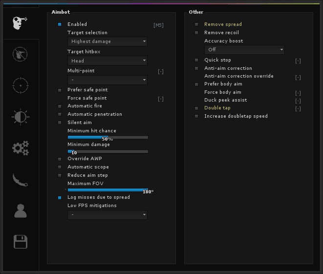
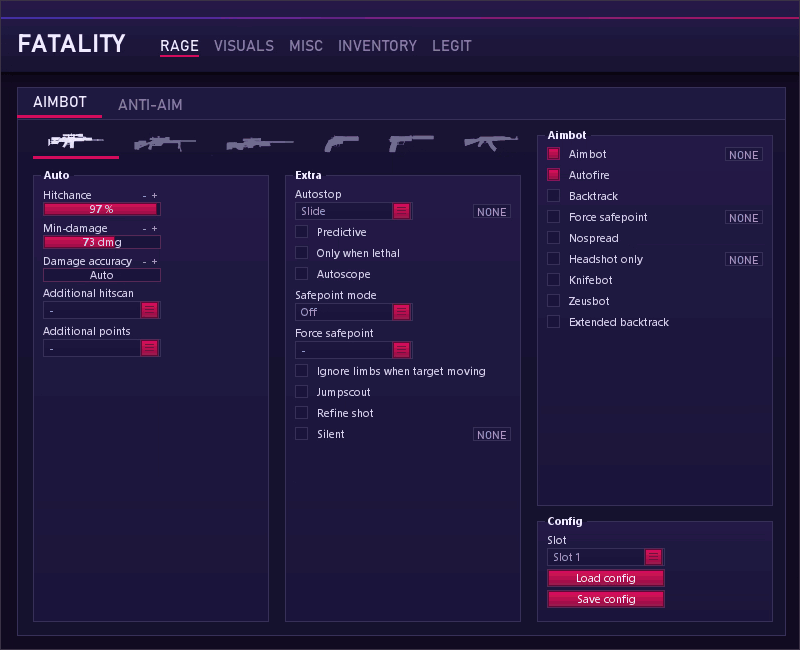

Icarus 3 is a rewrite: one Minecraft-free core with a thin adapter per Minecraft version and loader, so the same mod code runs from 1.7.10 to 26.3 on Forge, Fabric and NeoForge.

| `Themes.SKEET` | `Themes.FATALITY` |
|---|---|
|  |  |

## Install

```groovy
repositories { maven { url "https://repo.dreamys.studio/" } }
dependencies { implementation "studio.dreamys:icarus-<loader>-<minecraft version>:3.0.0" }
```

The jars are also attached below, one per target:

| Minecraft | Jars |
|---|---|
| 1.7.10, 1.8.9, 1.12.2 | `icarus-forge-<version>` (shade it) |
| 1.16.5, 1.20.1 | `icarus-fabric-<version>`, `icarus-forge-<version>` |
| 1.21.1 | `icarus-fabric-1.21.1`, `icarus-neoforge-1.21.1` |
| 26.3 | `icarus-fabric-26.3`, `icarus-neoforge-26.3` (builds, not tested in game) |

Fabric, Forge 1.16.5+ and NeoForge jars are a small mod (id `icarus`) to ship with Jar-in-Jar; none of them needs Fabric API.

## What's new

- **Two themes** recreating the skeet (gamesense) and fatality CS:GO menus, measured frame by frame from review footage, including:
  - hinted text;
  - colour pickers with copy and paste;
  - list boxes with search;
  - keybind modes (always on, on hotkey, toggle, off hotkey) on every bindable row;
  - fatality's tab glitch and header pulse.
- **The menu itself:**
  - fades in and out;
  - shrinks to fit small screens;
  - stays on screen after a resize;
  - the menu key also closes it.
- **The theme lays everything out:** groups take `column`, `order`, `pinBottom` and `height` hints instead of coordinates.
- **New setting types:** multi-select dropdowns, colours, list boxes and `Label` rows.
- **New annotations:**
  - `@IShowIf` hides a row until a checkbox is ticked.
  - `@IAttach` puts a colour swatch on the row above.
  - `@ILabel`, `@IDisabled` and `@IWarning` set a row's text and state.
- **Configs:** named configs with load, save, delete, reset and clipboard import/export, or a single auto-saved config with `.configUi(false)`. Loading a config that was never saved resets to the defaults.
- **HUD:** themed toasts (`mod.toasts()`), drawn over the open menu too, and a themed `Watermark`.
- **Runtime changes:** `mod.setAccent(...)`, `mod.setMenuScale(...)` and `mod.isKeybindActive(...)`.
- **Performance:** the whole menu is normally one draw call from a shared atlas, and steady frames don't allocate.

## Upgrading from v2

- `Icarus.init(modid, window)` → `Icarus.create(modid, theme)`.
- `@IGroup(x, y)` → `@IGroup(column, order)`.
- `NotificationManager.send(...)` → `mod.toasts().send(...)`.
- `CallbackManager.register(...)` → `mod.onChange(...)`.
- `Icarus.provideComponent(...)` → `mod.replaceWidget(...)`.
- `org.lwjgl.input.Keyboard` → `studio.dreamys.icarus.input.Keys`. The codes are the same, so `@IKeybind` values keep working.
- v2's `<game>/<modid>/config.json` and `keybind.json` are migrated automatically.
- Reflections is no longer a dependency.

## Known limitations

- **Fonts have to be installed.** The themes use system fonts:
  - skeet: Verdana;
  - fatality: Segoe UI Semibold, Segoe UI and Bahnschrift.

  Windows 10 and 11 ship them; elsewhere Icarus falls back to DejaVu Sans, Tahoma or Arial, and the menus won't match exactly.
- **NeoForge 26.3 builds but is untested.** Its dev client doesn't start (a Unimined 2.0.2 bug).
- **The example mod's page sets are incomplete.** They have almost every element from the reference footage, but a few things never appear in it: fatality's LEGIT tab, skeet's Anti-aim tab and the bottom of skeet's Effects group.

## Credits

The menu designs belong to gamesense / skeet and fatality; Icarus isn't affiliated with either. Measurements and icons come from the YouTube reviews "My Brutally Honest Skeet.cc Review" and "My Brutally Honest Fatality.win Review". `undefeated.ttf` is the community "undefeated" CS:GO icon font.

Licensed under GPL-3.0.
