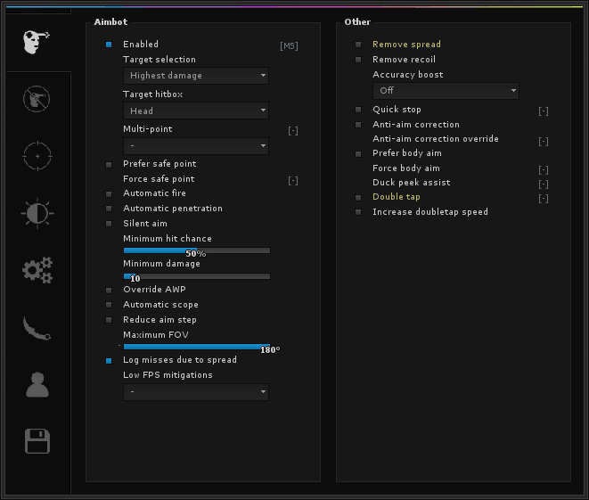
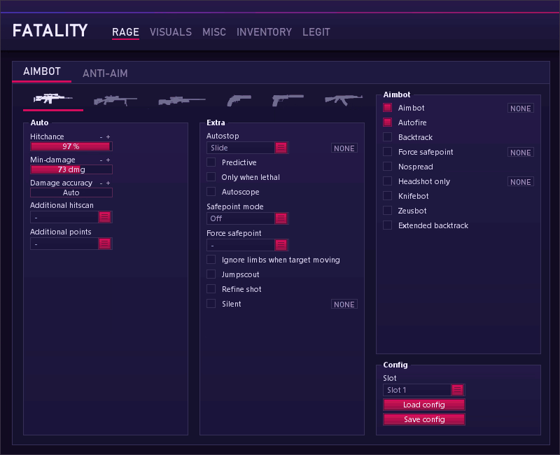

# Icarus
> rebranded from MineSenseUI

A [lightweight](#lightweightness) GUI and config library for Minecraft mods. You describe your settings as annotated static fields; Icarus builds the menu, saves the configs and handles keybinds. The menu styles recreate two popular CS:GO cheat menus, skeet (gamesense) and fatality, measured frame by frame from review footage (see [Credits](#credits)). A fully working example mod is in [testmod](testmod/src/main/java/studio/dreamys/test).

Since v3, Icarus is split into a Minecraft-free core and a thin adapter per Minecraft version and mod loader, so the same mod code runs on all of them.

| `Themes.SKEET` | `Themes.FATALITY` |
|---|---|
|  |  |

## Supported versions

| Minecraft | Fabric | Forge | NeoForge |
|---|---|---|---|
| 1.7.10 | | ✅ | |
| 1.8.9 | | ✅ | |
| 1.12.2 | | ✅ | |
| 1.16.5 | ✅ | ✅ | |
| 1.20.1 | ✅ | ✅ | |
| 1.21.1 | ✅ | | ✅ |
| 26.3 | ✅ | | ⚠️ builds, untested (see [Building](#building)) |

Each jar targets exactly one Minecraft version and loader, and its metadata only allows that version, so pick the jar matching the version your mod is built for. Other versions (for example 1.18.2 or 1.20.4) aren't built yet, but each can be added as one more adapter.

## Setup

```groovy
repositories {
    maven { url "https://repo.dreamys.studio/" }
}

dependencies {
    // studio.dreamys:icarus-<loader>-<minecraft version>:<icarus version>
    implementation "studio.dreamys:icarus-fabric-1.21.1:3.0.0"
}
```

The jars are also attached to each [GitHub release](https://github.com/DxxxxY/Icarus/releases). The v2 artifact (`studio.dreamys:Icarus:2.0.0`) is the old Forge 1.8.9-only version.

- **Forge 1.7.10, 1.8.9 and 1.12.2:** the jar is a plain library. Shade it into your mod.
- **Fabric, Forge 1.16.5+ and NeoForge:** the jar is a small mod with the id `icarus`. Ship it inside your mod (Jar-in-Jar), or have players install it next to your mod. It doesn't need Fabric API.

### Fonts

The themes draw text with the system's fonts, so the fonts they were measured with have to be installed for the menus to look like the GIFs above. Windows 10 and 11 ship all of them; on Linux or macOS, install them or Icarus falls back to the next font in the list:

| Theme | Fonts (fallbacks) |
|---|---|
| skeet | Verdana (DejaVu Sans, Tahoma) |
| fatality | Segoe UI Semibold and Segoe UI (Tahoma, DejaVu Sans, Arial), Bahnschrift (DIN, Segoe UI, Arial) |

The weapon icons come with Icarus and need nothing installed.

## Usage

Your mod code only talks to the core API, so it's the same on every version and loader. Only the entrypoint that calls `Icarus.create` is loader-specific.

### Pages

Annotate classes in your mod with `@IPage`. Every `@IGroup` inside a page becomes a group box and its static fields become widgets. A page can also hold `@ISubPage` classes (a second row of tabs), each holding groups.

```java
@IPage(icon = "rage", order = 0) // tab icon (a theme icon name, or a character of the icon font) and position
public class Combat {
    @IGroup(column = 0) // the theme places groups; column, order, pinBottom and height are hints
    public static class KillAura {
        @IKeybind(Keys.KEY_6)
        public static Runnable Button = () -> System.out.println("Button pressed!");

        @IKeybind(Keys.KEY_7)
        public static boolean Enabled = true;

        @IAttach // drawn on the row above (a swatch next to its checkbox)
        public static Color Enabled_color = new Color(29, 122, 215);

        @IShowIf("Enabled") // only shown while "Enabled" is ticked
        @DropdownOptions({"Option 1", "Option 2", "Option 3"})
        public static String Choice = "Option 1";

        @DropdownOptions({"Head", "Chest", "Legs"})
        public static String[] Hitboxes = {"Head"};

        @FieldOptions(maxLength = 32)
        public static String Name = "Hello";

        @SliderOptions(min = 0, max = 100, onlyInt = true, units = "%")
        public static int Range = 50; // double, float, int or long

        @IKeybind(Keys.KEY_LSHIFT) // a text row with a keybind, e.g. "Activation type"
        public static Label Activation_type;

        public static final ListModel Scripts = new ListModel("a.lua", "b.lua");
    }
}
```

| Field | Widget |
|---|---|
| `Runnable` | button (bindable with `@IKeybind`) |
| `boolean` | checkbox (bindable with `@IKeybind`) |
| `String` + `@DropdownOptions` | dropdown |
| `String[]` + `@DropdownOptions` | multi-select dropdown |
| `String` | text field (`@FieldOptions` sets the length limit) |
| number + `@SliderOptions` | slider |
| `java.awt.Color` | colour picker (with alpha, copy and paste) |
| `ListModel` | list box with search (the selection is saved) |
| `Label` | text row (bindable with `@IKeybind`) |

Other annotations: `@ILabel("Auto-accept matchmaking")` for text a Java name can't spell (underscores are shown as spaces otherwise), `@IDisabled` greys a setting out, `@IWarning` draws its label in the theme's warning colour, and `@IShowIf(value, not)` hides a row until a checkbox in the same group is ticked (or unticked).

Icarus finds pages by scanning your mod's own jar (or classes, in dev) for `@IPage`, so there's nothing to register.

### Initialisation

Call `Icarus.create` once, on the client thread, after the game window exists:

```java
IcarusMod mod = Icarus.create("yourmodid", Themes.SKEET);

// with options
IcarusMod mod = Icarus.create("yourmodid", Themes.FATALITY, IcarusOptions.builder()
        .menuKey(Keys.KEY_INSERT)       // Right Shift by default; pressing it again closes the menu
        .accent(new Color(212, 6, 90))  // the theme's own accent by default
        .menuScale(1.25)                // menu size on top of Minecraft's GUI scale
        .configUi(false)                // see "Configs"
        .themeSelector(false));         // players may switch themes by default
```

Where the example mod calls it on each loader:

| Loader | Where |
|---|---|
| Forge 1.7.10 / 1.8.9 / 1.12.2 | `FMLPreInitializationEvent` |
| Forge 1.16.5+ / NeoForge | `FMLClientSetupEvent`, inside `event.enqueueWork(...)` |
| Fabric | a mixin at the end of `Minecraft`'s constructor (Fabric's client entrypoint runs before the window exists) |

Several mods can use Icarus in the same game; each has its own `IcarusMod`, menu and configs.

### Themes

`Themes.SKEET` (dark grey, icon tabs on the left, multi-colour strip, two columns) and `Themes.FATALITY` (indigo and pink, text tabs in the header, three columns) are built in. The menu fades in and out, and shrinks to fit when the screen is too small for it. A theme does all the layout and drawing, so a new look is one class implementing `Theme` (or extending `BaseTheme`), registered with `Themes.register`. Players can switch themes from the config UI unless you turn the selector off. `mod.setAccent(argb)` and `mod.setMenuScale(scale)` change the accent and size at runtime (the example mod wires them to its "Menu color" and "DPI scale" settings).

### Configs

Settings live in `config/<modid>/`. By default the menu has a config UI (named configs with load, save, delete, reset, and import/export through the clipboard), and changes are only written when the player presses Save. Loading a config that was never saved resets everything to the defaults. With `.configUi(false)` there's a single config that saves itself after each change. Icarus v2's `<game>/<modid>/config.json` and `keybind.json` are migrated automatically.

### Callbacks, keys and HUD

```java
mod.onChange(Combat.KillAura.class, "Enabled", (Boolean enabled) -> System.out.println("KillAura: " + enabled));
mod.addKeyListener(key -> { if (key == Keys.KEY_K) mod.toasts().send("Hello", "World"); });
mod.addHud(new Watermark("yourmod | v1.0"));
mod.setFooter("left", "center", "right"); // footer text in the menu (empty by default)

if (mod.isKeybindActive(Combat.KillAura.class, "Activation_type")) { /* held, toggled on or always on */ }
```

Use `studio.dreamys.icarus.input.Keys` instead of LWJGL's `Keyboard`. The codes are the same as LWJGL2's, so `@IKeybind` values from v2 keep working; newer versions translate GLFW (1.13–1.21) and SDL (26.x) key codes to them. In the menu, click a keybind to rebind it (Escape cancels, Backspace clears) and right-click it to pick its mode: always on, on hotkey, toggle or off hotkey. Toasts and the watermark are drawn in the theme's style, and toasts stay on top of the open menu.

### Upgrading from v2

- `Icarus.init(modid, window)` → `Icarus.create(modid, theme)`; the menu window is created and placed by the theme.
- `@IGroup(x, y)` → `@IGroup(column, order)`; groups are laid out by the theme.
- `NotificationManager.send(...)` → `mod.toasts().send(...)`, `CallbackManager.register(...)` → `mod.onChange(...)`, `Icarus.provideComponent(...)` → `mod.replaceWidget(...)`.
- Replace `org.lwjgl.input.Keyboard` with `Keys`. The Reflections library is no longer needed.

## [Wiki](https://github.com/DxxxxY/Icarus/wiki/)

## Lightweightness
- Everything is rendered with what the game already ships; no extra rendering libraries.
- Other than importing this library, nothing is needed: no Fabric API, no Reflections.
- Pages are found by scanning only your mod's own classes, and only classes that mention `@IPage` are loaded.
- The whole menu is normally a single draw call: text, shapes and images share one texture atlas, and steady frames don't allocate.
- Settings are only written when they change (or when the player presses Save).

## Example mod

[testmod](testmod/src/main/java/studio/dreamys/test) has a page set per theme that recreates the menus from the reference footage: every tab, group and setting that can be seen in the videos, with the same labels, defaults and order. Almost every element is there; a few couldn't be, because the footage never shows them (fatality's LEGIT tab is never opened, skeet's Anti-aim tab couldn't be checked against it, and the bottom of skeet's Effects group is never scrolled into view).

It also adds a watermark, and K / J / L send test toasts in game. Environment variables for the dev clients:

| Variable | Effect |
|---|---|
| `ICARUS_TEST_THEME=fatality` | use the fatality theme and pages (skeet by default) |
| `ICARUS_TEST_OPEN=1` | open the menu on the title screen (with a test toast), so every platform can be checked without a world |

`./gradlew :testmod:snapshot -Pargs="<theme> <scale> <tab> <out.png>"` renders a theme's menu headlessly, which is how it was compared with the footage.

## Building

Requires JDK 17+ to run Gradle. Gradle downloads the JDKs each target needs (8, 17, 21 and 25) through toolchains.

```
./gradlew build
```

Jars end up in `platforms/<target>/build/libs` (and `platforms/<mc-version>/<loader>/build/libs`). Pushing a `vX.Y.Z` tag builds every target with that version, deploys the jars to the Maven repository and creates the GitHub release ([release.yml](.github/workflows/release.yml)).

```
core/                        Minecraft-free library code (plain Java 8)
testmod/                     the example mod, shared by every target
platforms/forge-<version>/   Forge 1.7.10, 1.8.9, 1.12.2
platforms/mc-<version>/      common/ (code shared by that version's loaders) + one project per loader
platforms/mc-26.3/           a separate included build (see below)
```

Every target builds with [Unimined](https://github.com/unimined/unimined) 1.4.1, except Minecraft 26.3. Unimined 1.x predates unobfuscated Minecraft, so `platforms/mc-26.3` is its own build on Unimined 2.0.2. Its `buildSrc` holds workarounds for 2.0.2 bugs, each marked for deletion once fixed upstream. The NeoForge 26.3 dev client doesn't start yet (FML fails with "version is null"), because Unimined 2.0.2 builds the 26.3 dev jar without NeoForge's patches. The plan is to move every target to Unimined 2.x once it matures.

Launch a dev client with the example mod from a target's directory:

| Target | Task |
|---|---|
| Forge (all), NeoForge | `runClient` |
| Fabric 1.16.5 – 1.21.1 | `testmodRunClient` |
| Fabric 26.3 | `runTestmodClient` |

## Credits

- The menu designs belong to [gamesense / skeet](https://gamesense.pub) and [fatality](https://fatality.win). Icarus isn't affiliated with either; the themes are recreations for Minecraft.
- Measurements, colours, the skeet tab icons and the weapon icons of both themes were taken from the YouTube reviews "My Brutally Honest Skeet.cc Review" and "My Brutally Honest Fatality.win Review".
- The weapon icon font `undefeated.ttf` is the "undefeated" CS:GO icon font shared in the CS:GO community; it's only a fallback for weapon icons that weren't cut from the footage.
- Minecraft is a trademark of Mojang; Icarus isn't affiliated with Mojang or Microsoft.

## License

[GPL-3.0](LICENSE)
