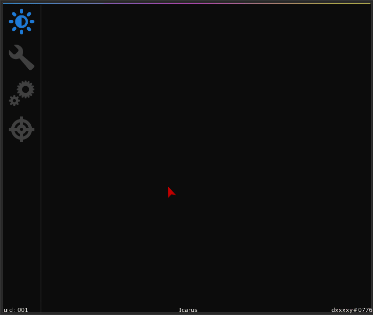

# Icarus
> rebranded from MineSenseUI

A very simple and [lightweight](#lightweightness) GUI and config library for Minecraft mods, with swappable menu styles inspired by popular CS:GO cheat menus (recreated with original assets, not copies). A fully working example mod using this library can be found in [testmod](testmod/src/main/java/studio/dreamys/test).

Since v3, Icarus is split into a Minecraft-free core and a thin adapter per Minecraft version and mod loader, so the same mod code runs on all of them.

## Supported versions

| Minecraft | Fabric | Forge | NeoForge |
|---|---|---|---|
| 1.7.10 | | ✅ | |
| 1.8.9 | | ✅ | |
| 1.12.2 | | ✅ | |
| 1.16.5 | ✅ | ✅ | |
| 1.20.1 | ✅ | ✅ | |
| 1.21.1 | ✅ | | ✅ |
| 26.3 | ✅ | | ⚠️ builds, untested (see [Building](#building)) |

Each jar targets exactly one Minecraft version and loader, and its metadata only allows that version, so pick the jar matching the version your mod is built for. Other versions (for example 1.18.2 or 1.20.4) aren't built yet, but each can be added as one more adapter.

## Setup

> v3 isn't published to a Maven repository yet. Until it is, build the jars yourself (see [Building](#building)) and depend on the one for your target. The v2 artifact at `https://repo.dreamys.studio/` (`studio.dreamys:Icarus`) is still the old Forge 1.8.9-only version.

The jar for each target is `icarus-<loader>-<minecraft version>-<icarus version>.jar`, for example `icarus-fabric-1.21.1-3.0.0.jar`:

- **Forge 1.7.10, 1.8.9 and 1.12.2:** the jar is a plain library. Shade it into your mod.
- **Fabric, Forge 1.16.5+ and NeoForge:** the jar is a small mod with the id `icarus`. Ship it inside your mod (Jar-in-Jar), or have players install it next to your mod. It doesn't need Fabric API.

## Usage

Your mod code only talks to the core API, so it's the same on every version and loader. Only the entrypoint that calls `Icarus.create` is loader-specific.

### Pages

Annotate classes in your mod with `@IPage`. Every `@IGroup` inside a page becomes a group box and its static fields become widgets. A page can also hold `@ISubPage` classes (a second row of tabs), each holding groups.

```java
@IPage(value = 's', order = 0) // tab icon (a character of the bundled icon font) and position
public class Combat {
    @IGroup(column = 0) // the theme places groups; column, order and pinBottom are hints
    public static class KillAura {
        @IKeybind(Keys.KEY_6)
        public static Runnable Button = () -> System.out.println("Button pressed!");

        @IKeybind(Keys.KEY_7)
        public static boolean Enabled = true;

        @DropdownOptions({"Option 1", "Option 2", "Option 3"})
        public static String Choice = "Option 1";

        @DropdownOptions({"Head", "Chest", "Legs"})
        public static String[] Hitboxes = {"Head"};

        @FieldOptions(maxLength = 32)
        public static String Name = "Hello";

        @SliderOptions(min = 0, max = 100, onlyInt = true, units = "%")
        public static int Range = 50; // double, float, int or long

        public static Color Tint = new Color(29, 122, 215);

        public static final ListModel Scripts = new ListModel("a.lua", "b.lua");
    }
}
```

| Field | Widget |
|---|---|
| `Runnable` | button (bindable with `@IKeybind`) |
| `boolean` | checkbox (bindable with `@IKeybind`) |
| `String` + `@DropdownOptions` | dropdown |
| `String[]` + `@DropdownOptions` | multi-select dropdown |
| `String` | text field (`@FieldOptions` sets the length limit) |
| number + `@SliderOptions` | slider |
| `java.awt.Color` | colour picker (with alpha) |
| `ListModel` | list box (the selection is saved) |

Icarus finds pages by scanning your mod's own jar (or classes, in dev) for `@IPage`, so there's nothing to register. Underscores in names are shown as spaces.

### Initialisation

Call `Icarus.create` once, on the client thread, after the game window exists:

```java
IcarusMod mod = Icarus.create("yourmodid", Themes.CLASSIC);

// with options
IcarusMod mod = Icarus.create("yourmodid", Themes.NEON, IcarusOptions.builder()
        .menuKey(Keys.KEY_INSERT)       // Right Shift by default
        .accent(new Color(212, 6, 90))  // the theme's own accent by default
        .configUi(false)                // see "Configs"
        .themeSelector(false));         // players may switch themes by default
```

Where the example mod calls it on each loader:

| Loader | Where |
|---|---|
| Forge 1.7.10 / 1.8.9 / 1.12.2 | `FMLPreInitializationEvent` |
| Forge 1.16.5+ / NeoForge | `FMLClientSetupEvent`, inside `event.enqueueWork(...)` |
| Fabric | a mixin at the end of `Minecraft`'s constructor (Fabric's client entrypoint runs before the window exists) |

Several mods can use Icarus in the same game; each has its own `IcarusMod`, menu and configs.

### Themes

`Themes.CLASSIC` (dark grey, icon tabs on the left, multi-colour accent strip) and `Themes.NEON` (indigo and pink, text tabs on top, three columns) are built in. A theme does all the layout and drawing, so a new look is one class implementing `Theme` (or extending `BaseTheme`), registered with `Themes.register`. Players can switch themes from the config UI unless you turn the selector off.

### Configs

Settings live in `config/<modid>/`. By default the menu has a config UI (named configs with load, save, delete, reset, and import/export through the clipboard), and changes are only written when the player presses Save. With `.configUi(false)` there's a single config that saves itself after each change. Icarus v2's `<game>/<modid>/config.json` and `keybind.json` are migrated automatically.

### Callbacks, keys and HUD

```java
mod.onChange(Combat.KillAura.class, "Enabled", (Boolean enabled) -> System.out.println("KillAura: " + enabled));
mod.addKeyListener(key -> { if (key == Keys.KEY_K) mod.toasts().send("Hello", "World"); });
mod.addHud(new Watermark("yourmod | v1.0"));
mod.setFooter("left", "center", "right"); // footer text in the menu (empty by default)
```

Use `studio.dreamys.icarus.input.Keys` instead of LWJGL's `Keyboard`. The codes are the same as LWJGL2's, so `@IKeybind` values from v2 keep working; newer versions translate GLFW (1.13–1.21) and SDL (26.x) key codes to them. In the menu, click a keybind to rebind it: Escape cancels, Backspace clears.

### Upgrading from v2

- `Icarus.init(modid, window)` → `Icarus.create(modid, theme)`; the menu window is created and placed by the theme.
- `@IGroup(x, y)` → `@IGroup(column, order)`; groups are laid out by the theme.
- `NotificationManager.send(...)` → `mod.toasts().send(...)`, `CallbackManager.register(...)` → `mod.onChange(...)`, `Icarus.provideComponent(...)` → `mod.replaceWidget(...)`.
- Replace `org.lwjgl.input.Keyboard` with `Keys`. The Reflections library is no longer needed.

## [Wiki](https://github.com/DxxxxY/Icarus/wiki/)

## Lightweightness
- Everything is rendered with what the game already ships; no extra rendering libraries.
- Other than importing this library, nothing is needed: no Fabric API, no Reflections.
- Pages are found by scanning only your mod's own classes, and only classes that mention `@IPage` are loaded.
- The whole menu is normally a single draw call: text, shapes and images share one texture atlas, and steady frames don't allocate.
- Settings are only written when they change (or when the player presses Save).

## Building

Requires JDK 17+ to run Gradle. Gradle downloads the JDKs each target needs (8, 17, 21 and 25) through toolchains.

```
./gradlew build
```

Jars end up in `platforms/<target>/build/libs` (and `platforms/<mc-version>/<loader>/build/libs`).

```
core/                        Minecraft-free library code (plain Java 8)
testmod/                     the example mod, shared by every target
platforms/forge-<version>/   Forge 1.7.10, 1.8.9, 1.12.2
platforms/mc-<version>/      common/ (code shared by that version's loaders) + one project per loader
platforms/mc-26.3/           a separate included build (see below)
```

Every target builds with [Unimined](https://github.com/unimined/unimined) 1.4.1, except Minecraft 26.3. Unimined 1.x predates unobfuscated Minecraft, so `platforms/mc-26.3` is its own build on Unimined 2.0.2. Its `buildSrc` holds workarounds for 2.0.2 bugs, each marked for deletion once fixed upstream. The NeoForge 26.3 dev client doesn't start yet, because Unimined 2.0.2 builds the 26.3 dev jar without NeoForge's patches. The plan is to move every target to Unimined 2.x once it matures.

Launch a dev client with the example mod from a target's directory (set `ICARUS_TEST_OPEN=1` to open the menu on the title screen, and `ICARUS_TEST_THEME=neon` to start with the other theme):

| Target | Task |
|---|---|
| Forge (all), NeoForge | `runClient` |
| Fabric 1.16.5 – 1.21.1 | `testmodRunClient` |
| Fabric 26.3 | `runTestmodClient` |

## Menu (v2, 09/02/2022):

