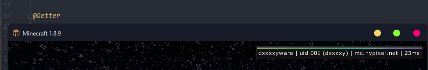

# Icarus
> rebranded from MineSenseUI

A very simple and [lightweight](#lightweightness) GUI and config library for Minecraft mods, heavily inspired by the GameSense/Skeet CS:GO cheat (not an exact copy). A fully working example mod using this library can be found in [testmod](testmod/src/main/java/studio/dreamys/test).

Since v3, Icarus is split into a Minecraft-free core and a thin adapter per Minecraft version and mod loader, so the same mod code runs on all of them.

## Supported versions

| Minecraft | Fabric | Forge | NeoForge |
|---|---|---|---|
| 1.7.10 | | ✅ | |
| 1.8.9 | | ✅ | |
| 1.12.2 | | ✅ | |
| 1.16.5 | ✅ | ✅ | |
| 1.20.1 | ✅ | ✅ | |
| 1.21.1 | ✅ | | ✅ |
| 26.3 | ✅ | | ⚠️ builds, untested (see [Building](#building)) |

Each jar targets exactly one Minecraft version and loader, and its metadata only allows that version, so pick the jar matching the version your mod is built for. Other versions (for example 1.18.2 or 1.20.4) aren't built yet, but each can be added as one more adapter.

## Setup

> v3 isn't published to a Maven repository yet. Until it is, build the jars yourself (see [Building](#building)) and depend on the one for your target. The v2 artifact at `https://repo.dreamys.studio/` (`studio.dreamys:Icarus`) is still the old Forge 1.8.9-only version.

The jar for each target is `icarus-<loader>-<minecraft version>-<icarus version>.jar`, for example `icarus-fabric-1.21.1-3.0.0.jar`:

- **Forge 1.7.10, 1.8.9 and 1.12.2:** the jar is a plain library. Shade it into your mod.
- **Fabric, Forge 1.16.5+ and NeoForge:** the jar is a small mod with the id `icarus`. Ship it inside your mod (Jar-in-Jar), or have players install it next to your mod. It doesn't need Fabric API.

## Usage

Your mod code only talks to the core API, so it's the same on every version and loader. Only the entrypoint that calls `Icarus.init` is loader-specific.

### Pages

Annotate classes in your mod with `@IPage`. Every `@IGroup` inside a page becomes a group box, and its static fields become components:

```java
@IPage('v') // page icon, a character from the icon font
public class Combat {
    @IGroup(x = 47.5, y = 10)
    public static class KillAura {
        @IKeybind(Keys.KEY_6)
        public static Runnable Button = () -> System.out.println("Button pressed!");

        @IKeybind(Keys.KEY_7)
        public static boolean Checkbox = true;

        @DropdownOptions({"Option 1", "Option 2", "Option 3"})
        public static String Choice = "Option 1";

        @SliderOptions(min = 0, max = 100, onlyInt = true, units = "%")
        public static double Slider = 1;
    }
}
```

Icarus finds pages by scanning your mod's own jar (or classes, in dev) for `@IPage`, so there's nothing to register. Values are saved to `<game directory>/<modid>/config.json` and keybinds to `keybind.json` next to it.

### Initialisation

Call `Icarus.init` once, on the client thread, after the game window exists, passing your mod id and the window:

```java
Platform platform = Icarus.getPlatform();
Window window = new Window(platform.getDisplayWidth() / 2.0, platform.getDisplayHeight() / 4.0, 731 / 2.0, 617 / 2.0, new Color(29, 122, 215));
Icarus.init("yourmodid", window);
```

Right Shift opens the menu by default. Where to call it on each loader:

| Loader | Where the example mod calls `Icarus.init` |
|---|---|
| Forge 1.7.10 / 1.8.9 / 1.12.2 | `FMLPreInitializationEvent` |
| Forge 1.16.5+ / NeoForge | `FMLClientSetupEvent`, inside `event.enqueueWork(...)` |
| Fabric | a mixin at the end of `Minecraft`'s constructor (Fabric's client entrypoint runs before the window exists) |

### Keys

Use `studio.dreamys.icarus.input.Keys` instead of LWJGL's `Keyboard`. The codes are the same as LWJGL2's, so `@IKeybind` values and `keybind.json` files from v2 keep working. Newer versions translate GLFW (1.13–1.21) and SDL (26.x) key codes to them.

Icarus also passes on key presses, HUD rendering and client ticks, so you don't need loader events for them:

```java
Icarus.addKeyListener(key -> { if (key == Keys.KEY_K) NotificationManager.send(new Notification("Hello", "World")); });
Icarus.registerHud(hudElement); // renderHud() every frame, clientTick() every tick
```

### Upgrading from v2

- `Window` is no longer a `GuiScreen`. Open it with `Icarus.getPlatform().openScreen(window)`.
- Replace `org.lwjgl.input.Keyboard` with `Keys`, and Forge overlay or tick handlers with `Icarus.registerHud` / `Icarus.addKeyListener`.
- The Reflections library is no longer needed.

## [Wiki](https://github.com/DxxxxY/Icarus/wiki/)

## UI Components
- Button
- Checkbox
- Choice
- ~~Color~~ (coming soon)
- Combo
- Field
- Slider
- Keybind
- Group
- Page
- Window

## Extra
- [Notification](https://www.youtube.com/watch?v=624J5kAZqNw&ab_channel=DxxxxY)
- Watermark 

## Lightweightness
- Everything is rendered with what the game already ships; no extra rendering libraries.
- Other than importing this library, nothing is needed: no Fabric API, no Reflections.
- Pages are found by scanning only your mod's own classes, and only classes that mention `@IPage` are loaded.
- Reflected data is cached and accessed quicker.

## Building

Requires JDK 17+ to run Gradle. Gradle downloads the JDKs each target needs (8, 17, 21 and 25) through toolchains.

```
./gradlew build
```

Jars end up in `platforms/<target>/build/libs` (and `platforms/<mc-version>/<loader>/build/libs`).

```
core/                        Minecraft-free library code (plain Java 8)
testmod/                     the example mod, shared by every target
platforms/forge-<version>/   Forge 1.7.10, 1.8.9, 1.12.2
platforms/mc-<version>/      common/ (code shared by that version's loaders) + one project per loader
platforms/mc-26.3/           a separate included build (see below)
```

Every target builds with [Unimined](https://github.com/unimined/unimined) 1.4.1, except Minecraft 26.3. Unimined 1.x predates unobfuscated Minecraft, so `platforms/mc-26.3` is its own build on Unimined 2.0.2. Its `buildSrc` holds workarounds for 2.0.2 bugs, each marked for deletion once fixed upstream. The NeoForge 26.3 dev client doesn't start yet, because Unimined 2.0.2 builds the 26.3 dev jar without NeoForge's patches. The plan is to move every target to Unimined 2.x once it matures.

Launch a dev client with the example mod from a target's directory:

| Target | Task |
|---|---|
| Forge (all), NeoForge | `runClient` |
| Fabric 1.16.5 – 1.21.1 | `testmodRunClient` |
| Fabric 26.3 | `runTestmodClient` |

## Menu (as of 09/02/2022) is fully functional:

